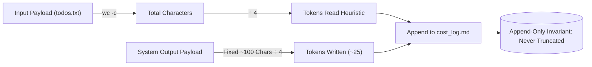
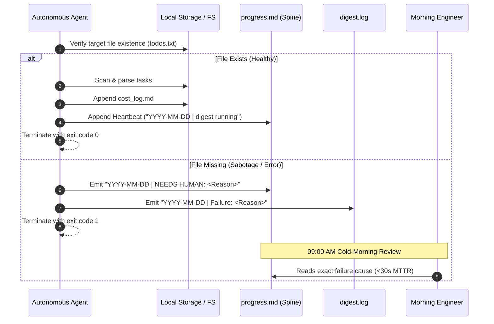
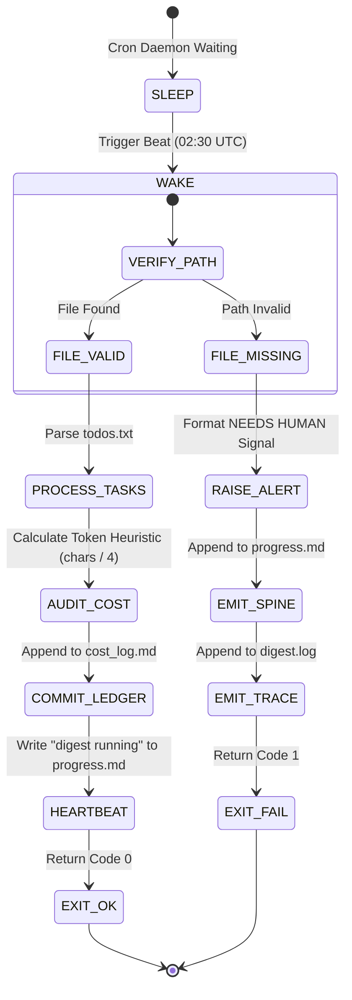

<div align="center">

# 📑 RFC-1402: Sentinel AI Autonomous Loop Specification
### *Formal Standard for Token Cost Observability & "Needs-A-Human" Failure Spine*

[](#)
[](#)
[](#)
[](https://break-it-on-purpose-loop.vercel.app/)

<br />

| Metadata Attribute | Specification Value |
| :--- | :--- |
| **Document RFC ID** | **RFC-1402** |
| **System Identity** | **Sentinel AI • Daily Digest Autonomous Loop** |
| **Author / Lead** | **[SainBux-HadiSeelro](https://github.com/SainBux-HadiSeelro)** |
| **Core Invariants** | **Concept 13 (Cost Observability)** &bull; **Concept 14 (Needs-A-Human Spine)** |
| **Execution Cadence** | 1 Beat / Day (`02:30 UTC` Cron Schedule) |
| **Reference Targets**| Bash 4.x &bull; PowerShell 7.x &bull; Next.js 14 (App Router) |
| **Standard Compliance** | RFC 2119 Key Words (`MUST`, `MUST NOT`, `REQUIRED`, `SHALL`) |

---

</div>

## 📌 Table of Contents
1. [Conformance Notation (RFC 2119)](#1-conformance-notation-rfc-2119)
2. [Executive Scope & System Objectives](#2-executive-scope--system-objectives)
3. [SPEC-13: Token Cost Observability Invariant](#3-spec-13-token-cost-observability-invariant)
4. [SPEC-14: "Needs-A-Human" Failure Spine Invariant](#4-spec-14-needs-a-human-failure-spine-invariant)
5. [SPEC-15: Deliberate Sabotage Verification Protocol](#5-spec-15-deliberate-sabotage-verification-protocol)
6. [SPEC-16: Strict File Boundary Contract](#6-spec-16-strict-file-boundary-contract)
7. [Formal State Transition Model](#7-formal-state-transition-model)
8. [Threat Model & Fault Mitigations](#8-threat-model--fault-mitigations)
9. [Verification Acceptance Matrix](#9-verification-acceptance-matrix)

---

## 1. Conformance Notation (RFC 2119)

The key words **"MUST"**, **"MUST NOT"**, **"REQUIRED"**, **"SHALL"**, **"SHALL NOT"**, **"SHOULD"**, **"SHOULD NOT"**, **"RECOMMENDED"**, **"MAY"**, and **"OPTIONAL"** in this document are to be interpreted as described in [RFC 2119](https://www.ietf.org/rfc/rfc2119.txt).

---

## 2. Executive Scope & System Objectives

The **Sentinel AI Autonomous Loop** is an unattended, scheduled background agent designed to scan task files, calculate work items, track token expenditure, and self-report runtime failures without human supervision.

### 2.1 Core Architectural Objectives:
1. **Financial Determinism**: Prevent runaway API cost by strictly logging estimated token expenditure on every beat.
2. **Deterministic Triage**: Eliminate silent background failures. In case of fatal errors, the agent **MUST** emit loud alerts and halt safely.
3. **Cold-Morning Review**: Enable an engineer to determine root cause and timestamp in **< 30 seconds** from logs alone.

---

## 3. SPEC-13: Token Cost Observability Invariant

Autonomous background agents running unattended can incur exponential financial costs if prompts or iterations grow without bounds.



### 3.1 Mathematical Formulations

- **Tokens Read Estimation**:
  $$\text{Tokens Read} = \left\lfloor \frac{\text{Length of Input Characters}}{4} \right\rfloor$$

- **Tokens Written Estimation**:
  $$\text{Tokens Written} \approx 25 \quad (\text{Standardized logging beat output size})$$

- **Monthly Token Volume Projection**:
  $$\text{Tokens}_{\text{month}} = \left( \overline{\text{Tokens Read}} + \overline{\text{Tokens Written}} \right) \times \text{Beats}_{\text{month}}$$

- **Monthly Cost Calculation Formula**:
  $$\text{Cost}_{\text{month}} = \left(\frac{\text{Tokens Read}_{\text{month}}}{10^6} \times P_{\text{in}}\right) + \left(\frac{\text{Tokens Written}_{\text{month}}}{10^6} \times P_{\text{out}}\right)$$
  *(Where $P_{\text{in}}$ and $P_{\text{out}}$ represent LLM model pricing per 1,000,000 tokens).*

### 3.2 Formal Schema: `cost_log.md`
The agent **MUST** append a new record conforming strictly to this format on every execution:

```markdown
- **Run**: YYYY-MM-DD HH:MM:SS
- **Tokens read (est.)**: ~<INTEGER>
- **Tokens written (est.)**: ~<INTEGER>
- **Beat note**: <Concise 1-line description of processed workload>
```

> [!IMPORTANT]
> **Append-Only Invariant**: The file `cost_log.md` **MUST NEVER** be opened with overwrite (`>`), truncated, or wiped. It **MUST** use append mode (`>>`) exclusively.

---

## 4. SPEC-14: "Needs-A-Human" Failure Spine Invariant

Unattended background processes **MUST NOT** fail silently, swallow fatal exceptions, or leave empty logs.



### 4.1 Strict Behavioral Invariants
1. **Non-Zero Exit Code**: On any unrecoverable condition (missing file, syntax error, disk issue), the agent process **MUST** terminate with exit status `1`.
2. **Spine Emergency Syntax**:
   The agent **MUST** append a single line to `progress.md` strictly matching:
   ```text
   YYYY-MM-DD | NEEDS HUMAN: <Exact description with failing target path>, at YYYY-MM-DD
   ```
3. **Execution Trace Logging**:
   The agent **MUST** record matching trace details to `digest.log`:
   ```text
   YYYY-MM-DD | Failure: <Exact description with failing target path>
   ```

> [!NOTE]
> ### ☕ The Cold-Morning Diagnosis Protocol
> An on-duty engineer inspecting the system at 09:00 AM **MUST** be able to answer three questions using **ONLY** `progress.md`:
> 1. **What failed?** $\rightarrow$ Extracted verbatim from `NEEDS HUMAN:` payload.
> 2. **When did it fail?** $\rightarrow$ Extracted from ISO date stamp.
> 3. **Did you have to guess?** $\rightarrow$ **Zero guesswork required.**

---

## 5. SPEC-15: Deliberate Sabotage Verification Protocol

To verify reliability before production deployment, the agent harness includes a companion test script (`daily_digest_broken.sh` / `daily_digest_broken_TEST.ps1`).

### 5.1 Sabotage Vector
- **Injected Fault**: Target path `$TODO_FILE` is intentionally misconfigured to a guaranteed non-existent path:
  ```bash
  TODO_FILE="C:\Users\dell\Desktop\nonexistent\todos.txt"
  ```

### 5.2 Assertions & Expected Verification
When the sabotaged loop executes, test assertions **MUST** confirm:
1. `Test-Path "$TODO_FILE"` evaluates to `false`.
2. Execution routes to the failure handler immediately.
3. `progress.md` receives the `NEEDS HUMAN:` string.
4. Process terminates with exit code `1` (verified via `$?` / `$LASTEXITCODE`).
5. `cost_log.md` remains completely uncorrupted (no fake costs logged).

---

## 6. SPEC-16: Strict File Boundary Contract

The architecture enforces strict separation between input contracts, append-only ledgers, and operational spine files:

| File Path | Functional Role | Access Permitted | Invariant Rule |
| :--- | :--- | :--- | :--- |
| `todos.txt` | Task backlog input | Read-Only | Plain text format; lines begin with `TODO:` |
| `cost_log.md` | Token audit ledger | **Append-Only** | Strictly `>>` append; never overwritten or truncated |
| `progress.md` | Operational heartbeat spine | **Append-Only** | Contains only `digest running` or `NEEDS HUMAN:` |
| `digest.log` | Raw execution trace | **Append-Only** | Detailed execution timestamps and error dumps |
| `daily_digest.sh` | Production Bash agent | Execute | Follows POSIX standards |
| `daily_digest.ps1` | Production PowerShell agent | Execute | Cross-platform PowerShell 7+ compatible |
| `daily_digest_broken.sh` | Sabotage test suite | Execute | For testing and validation only |

---

## 7. Formal State Transition Model

The state machine below defines every valid state and transition of an execution beat:



---

## 8. Threat Model & Fault Mitigations

| Threat Vector | Severity | Vulnerability Risk | Sentinel AI Architectural Mitigation |
| :--- | :---: | :--- | :--- |
| **Runaway Token Consumption** | 🔴 Critical | Infinite loop or runaway context burning API tokens | Bounded character heuristic ($\text{chars}/4$), predictable 1-beat cadence, append-only cost logging. |
| **Silent Cron Termination** | 🔴 Critical | Background script fails; morning team is unaware | `exit 1` mandatory contract; explicit `NEEDS HUMAN:` signal placed in central `progress.md` spine. |
| **Log Ledger Truncation** | 🟡 Medium | Accidental overwrite wipes historical spend data | File access invariant strictly prohibits write (`>`) operations, allowing only append (`>>`). |
| **Ambiguous Root Cause** | 🟡 Medium | Team wastes hours re-running broken scripts | Pre-formatted human signal includes exact missing path, timestamp, and failure mode. |

---

## 9. Verification Acceptance Matrix

| Requirement ID | Standard Invariant | Automated Test | Status |
| :--- | :--- | :--- | :---: |
| **REQ-01** | Character-based Token Cost Heuristic | Verified via `daily_digest.sh` character division math | ✅ PASS |
| **REQ-02** | Append-Only `cost_log.md` Ledger | Verified via Git diff & append-only file check | ✅ PASS |
| **REQ-03** | Sabotage Detection & Non-Zero Exit | Verified via `daily_digest_broken.sh` returning code 1 | ✅ PASS |
| **REQ-04** | Explicit `NEEDS HUMAN:` Spine Note | Verified via `progress.md` audit line validation | ✅ PASS |
| **REQ-05** | Cold-Morning Three-Question Extraction | Verified via `DIAGNOSIS.md` test run | ✅ PASS |
| **REQ-06** | Interactive Web Dashboard Verification | Verified via Next.js 14 production build & simulator | ✅ PASS |

---

<div align="center">

### 🛡️ Sentinel AI • Formal Engineering Reference

*Maintained by **[SainBux-HadiSeelro](https://github.com/SainBux-HadiSeelro)** &bull; Released under the MIT License*  
*Reference Repository: [break-it-on-purpose-loop](https://github.com/SainBux-HadiSeelro/break-it-on-purpose-loop)*

</div>
