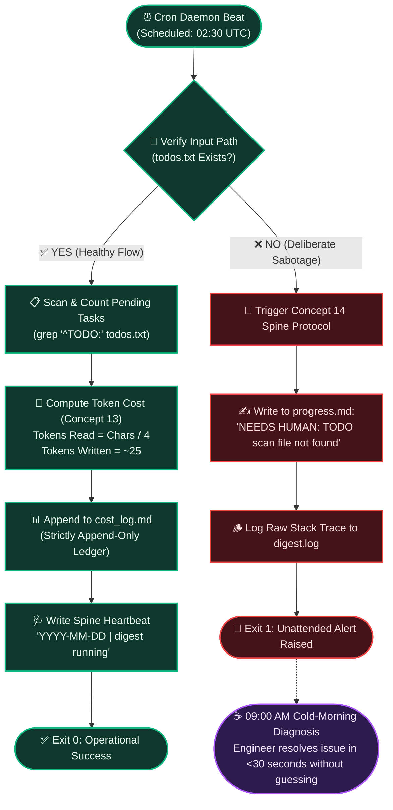

<div align="center">

# 🤖 Sentinel AI • Daily Digest Autonomous Loop
### *Self-Observing, Cost-Bounded & Self-Reporting Autonomous Background Agent*

[](https://nextjs.org/)
[](https://www.typescriptlang.org/)
[](https://tailwindcss.com/)
[](https://break-it-on-purpose-loop.vercel.app/)
[](https://break-it-on-purpose-loop.vercel.app/)
[](LICENSE)

<br />

<p align="center">
  <b>A battle-tested reference architecture for production-grade Autonomous AI Agents.</b><br>
  Demonstrates <b>Concept 13 (Token Cost Observability)</b> and <b>Concept 14 (Needs-A-Human Failure Spine)</b><br>
  paired with a rich, interactive Next.js 14 Web Command Center.
</p>

<br />

[🚀 **Launch Live App**](https://break-it-on-purpose-loop.vercel.app/) • [📋 System Specification](SPEC.md) • [💥 Sabotage Testing](FAILURE_TEST.md) • [☕ Cold Morning Diagnosis](DIAGNOSIS.md) • [⚡ Quickstart](#-quickstart)

---

</div>

## 🌟 Overview & Problem Statement

Unattended autonomous AI loops running on background cron triggers face two catastrophic vulnerabilities:

1. **💸 The Silent Money Pit (Unbounded Cost Expansion)**: A runaway loop or ballooning context window burns hundreds or thousands of dollars in LLM API tokens overnight without triggering any alarm.
2. **👻 The Phantom Crash (Silent Failures)**: When a background worker crashes, scripts exit silently. Engineering teams wake up to an out-of-sync system and spend hours deciphering cryptic stack traces.

**Sentinel AI** implements the structural antidote:
- **Concept 13 (Cost Observability)**: The agent calculates its own token footprint on every single execution beat ($\text{chars}/4$) and commits an append-only audit trail to `cost_log.md`.
- **Concept 14 (Needs-A-Human Spine)**: Sabotaged deliberately in testing (`daily_digest_broken.sh`) to prove that on any failure, it terminates with `exit 1` and stamps an unambiguous `NEEDS HUMAN:` emergency signal directly into `progress.md`.

---

## 📊 Architectural Benchmark

| Feature Capability | ⚠️ Standard Unattended Agent | 🛡️ Sentinel AI Loop Architecture |
| :--- | :--- | :--- |
| **Token Cost Tracking** | Hidden until monthly API billing shock | Real-time heuristic ($\text{chars}/4$), append-only `cost_log.md` |
| **Failure Notification** | Silent process termination, empty logs | Loud non-zero exit code (`exit 1`) + explicit `NEEDS HUMAN` signal |
| **Audit Log Invariant** | Frequently overwritten or truncated | Strictly append-only, permanent historical ledger |
| **Mean Time to Diagnosis** | 2–4 hours digging through raw console logs | **< 30 seconds** via the central `progress.md` spine |
| **Monthly Budget Guard** | Uncapped financial exposure | Predictable mathematical upper bound (< \$0.01 / month) |
| **Observability Dashboard**| Raw CLI or cloud vendor metric views | Interactive Next.js 14 Web Command Center with 1-click simulator |

---

## 🏗️ Autonomous Loop Architecture

The diagram below illustrates how each scheduled beat handles verification, cost tracking, and deliberate sabotage resilience:



---

## ⚡ The Two Engineering Pillars

### 1️⃣ Concept 13: Self-Observing Token Cost Guard

Every autonomous loop beat self-audits its token consumption and logs an immutable record:

- **Tokens Read**: Approximated by character count heuristic:
  $$\text{Tokens Read} = \left\lfloor \frac{\text{Length of Input Characters}}{4} \right\rfloor$$
- **Tokens Written**: Output logging payload size ($\approx 25$ tokens per run).
- **Append-Only Invariant**: `cost_log.md` is strictly append-only. It is **never overwritten, truncated, or erased**.
- **Monthly Budget Math**:
  $$\text{30 beats/month} \times \sim 25\text{ tokens/beat} \approx \mathbf{750\text{ tokens/month}} \quad (\ll \$0.01/\text{month})$$

```markdown
<!-- cost_log.md sample immutable record -->
- **Run**: 2026-08-23 02:32:55
- **Tokens read (est.)**: ~140
- **Tokens written (est.)**: ~25
- **Beat note**: 3 new TODOs found
```

#### Multi-Model Cost Projections (30 Days @ 1 Beat/Day)

| AI Model | Input / 1M | Output / 1M | Estimated Monthly Cost | Budget Guard Status |
| :--- | :--- | :--- | :--- | :---: |
| **Gemini 1.5 Flash** | \$0.075 | \$0.30 | **\$0.00001** | 🟢 Extremely Negligible |
| **GPT-4o mini** | \$0.150 | \$0.60 | **\$0.00003** | 🟢 Negligible |
| **Claude 3.5 Sonnet** | \$3.000 | \$15.00 | **\$0.00048** | 🟢 Safe Under Cap |

---

### 2️⃣ Concept 14: "Needs-A-Human" Unattended Failure Spine

To guarantee the agent never fails silently, we created a sabotaged counterpart: `daily_digest_broken.sh` (and PowerShell `daily_digest_broken_TEST.ps1`).

- **Sabotage Method**: `$TODO_FILE` path points to a non-existent directory (`C:\Users\dell\Desktop\nonexistent\todos.txt`).
- **Spine Protocol Contract**:
  1. Appends an unambiguous alert line to `progress.md`:
     ```text
     2026-08-23 | NEEDS HUMAN: TODO scan file not found: C:\Users\dell\Desktop\nonexistent\todos.txt, at 2026-08-23
     ```
  2. Emits execution trace to `digest.log`.
  3. Halts with non-zero exit code (`exit 1`).

> [!IMPORTANT]
> ### ☕ The "Cold-Morning Diagnosis" Test
> When an engineer checks the system at 09:00 AM using **ONLY** `progress.md` and `digest.log` (without reading code or running scripts):
>
> | Spine Diagnosis Question | Extracted Answer From Cold Logs Alone | Guessing Needed? |
> | :--- | :--- | :---: |
> | **1. What failed?** | `TODO scan file not found: C:\Users\dell\Desktop\nonexistent\todos.txt` | ❌ No |
> | **2. When did it fail?** | Exact timestamp `2026-08-23 02:30 UTC` | ❌ No |
> | **3. Did you have to guess?** | Zero guesswork required. Explicit `NEEDS HUMAN:` line signals cause and remediation. | ❌ No |

---

## 🖥️ Interactive Web Command Center

Built with **Next.js 14 (App Router)**, **TypeScript**, and **Tailwind CSS**, designed so technical architects and non-technical stakeholders alike can simulate and inspect the agent.

> [!TIP]
> **Live Interactive Cloud Demo**:  
> 👉 [https://break-it-on-purpose-loop.vercel.app/](https://break-it-on-purpose-loop.vercel.app/)  
> *Zero installation needed — test normal runs, trigger sabotage alerts, and inspect token pricing directly in your browser.*

### Dashboard Modules:

```
┌────────────────────────────────────────────────────────────────────────┐
│  🤖 1. AI Agent Playground    │ 1-Click healthy run & sabotage toggle  │
│  💰 2. Cost & Bill Guard      │ Dynamic cadence slider (1–24 runs/day) │
│  🚨 3. Safety & Spine Alerts  │ Cold-morning 3-question triage review  │
│  📋 4. Task List (Input)      │ Real-time prompt character/token count │
│  🏗️ 5. Architecture & Code    │ In-browser RFC reader & shell viewer   │
└────────────────────────────────────────────────────────────────────────┘
```

- **🤖 1-Click Agent Simulator**: Execute normal digest beats or trigger deliberate sabotage with live animated progress bars and terminal feedback.
- **💰 Interactive Cost Calculator**: Adjust execution cadence from 1 to 24 beats/day to inspect monthly financial projections across OpenAI, Anthropic, and Google models.
- **🚨 Visual Spine Alert Center**: Live badge indicators change from `Loop Ready` to `Alert Active` with step-by-step human remediation guides.
- **📋 Live Input Task Scanner**: Add or delete TODO items and watch token sizing recalculate in real-time.
- **🔄 Universal System Reset**: Instant 1-click restore to clean baseline state for demonstrations.

---

## 📁 Repository Structure

```text
break-it-on-purpose-loop/
├── 📜 SPEC.md                      # Formal RFC specification & invariants
├── 📜 readme.md                    # Primary documentation & architecture guide
├── ⚙️ daily_digest.sh               # Main Bash agent loop with Concept 13 token logging
├── 💥 daily_digest_broken.sh        # Sabotaged Bash script for Concept 14 testing
├── ⚙️ daily_digest.ps1              # Cross-platform PowerShell healthy agent script
├── 💥 daily_digest_broken_TEST.ps1  # Cross-platform PowerShell sabotage script
├── 📝 todos.txt                    # Scanned task input file (mock work backlog)
├── 📊 cost_log.md                  # Append-only token cost audit ledger
├── 📈 COST_ESTIMATE.md             # Formal cost calculation breakdown
├── 🩺 progress.md                  # Central system spine with HEARTBEAT & alerts
├── 🪵 digest.log                   # Raw execution and error trace log
├── 🔬 FAILURE_TEST.md              # Detailed sabotage test documentation
├── 🕵️ DIAGNOSIS.md                 # Cold-morning diagnosis verification report
├── 🌐 vercel.json                  # Zero-config Vercel deployment manifest
├── 📦 package.json                 # Next.js 14, React 18, Tailwind, Lucide dependencies
├── 📁 src/
│   ├── app/                        # Next.js App Router (layout.tsx, page.tsx, globals.css)
│   ├── components/                 # ControlCenter, CostExplainer, FailureExplainer, TodosTab
│   └── data/                       # Seed baseline logs and system specifications
```

---

## 🚀 Quickstart

### Option A: Open Hosted Web App
Access the deployed production app instantly:  
👉 **[break-it-on-purpose-loop.vercel.app](https://break-it-on-purpose-loop.vercel.app/)**

### Option B: Run Web Dashboard Locally
```bash
# 1. Clone the repository
git clone https://github.com/SainBux-HadiSeelro/break-it-on-purpose-loop.git
cd break-it-on-purpose-loop

# 2. Install dependencies
npm install

# 3. Launch the development server
npm run dev
```
Open **[http://localhost:3000](http://localhost:3000)** in your browser.

### Option C: Run via Command Line Interface (CLI)

#### Bash (Linux / macOS / WSL / Git Bash):
```bash
# Run healthy loop (tracks tokens, appends cost_log.md, reports heartbeat)
chmod +x ./daily_digest.sh ./daily_digest_broken.sh
./daily_digest.sh

# Run sabotaged loop (simulates failure, emits NEEDS HUMAN alert, exits with 1)
./daily_digest_broken.sh
```

#### PowerShell (Windows native):
```powershell
# Run healthy loop
.\daily_digest.ps1

# Run sabotaged loop
.\daily_digest_broken_TEST.ps1
```

---

## 📜 Formal System Invariants

| Specification ID | Invariant Name | Enforced Behavior | Verification Status |
| :--- | :--- | :--- | :---: |
| **SPEC-13** | **Cost Observability** | Token heuristic ($\text{chars}/4$) appended to `cost_log.md` on every run. Strictly append-only. | ✅ Enforced |
| **SPEC-14** | **Unattended Failure** | Unrecoverable failures emit `NEEDS HUMAN: <reason>` to `progress.md` and exit with `1`. | ✅ Enforced |
| **SPEC-15** | **Cold-Morning Triage** | Failure cause, path, and timestamp extractable without executing code or guessing. | ✅ Enforced |
| **SPEC-16** | **Contract Boundaries** | Clean file boundary separation between input (`todos.txt`), cost log (`cost_log.md`), and spine (`progress.md`). | ✅ Enforced |

---

## 🛠️ Tech Stack

- **Framework**: [Next.js 14 (App Router)](https://nextjs.org/)
- **Language**: [TypeScript 5](https://www.typescriptlang.org/)
- **Styling**: [Tailwind CSS 3.4](https://tailwindcss.com/)
- **Icons**: [Lucide React](https://lucide.dev/)
- **Automation Scripts**: Bash 4.x & PowerShell 7.x
- **Hosting**: [Vercel Edge Network](https://vercel.com/)

---

<div align="center">

### 👨‍💻 Author & Reference Architecture

Crafted with precision by **[SainBux-HadiSeelro](https://github.com/SainBux-HadiSeelro)**  
*Production Reference Implementation for Agentic AI & Autonomous Loop Engineering*

[](https://github.com/SainBux-HadiSeelro)
[](https://github.com/SainBux-HadiSeelro/break-it-on-purpose-loop)

</div>
